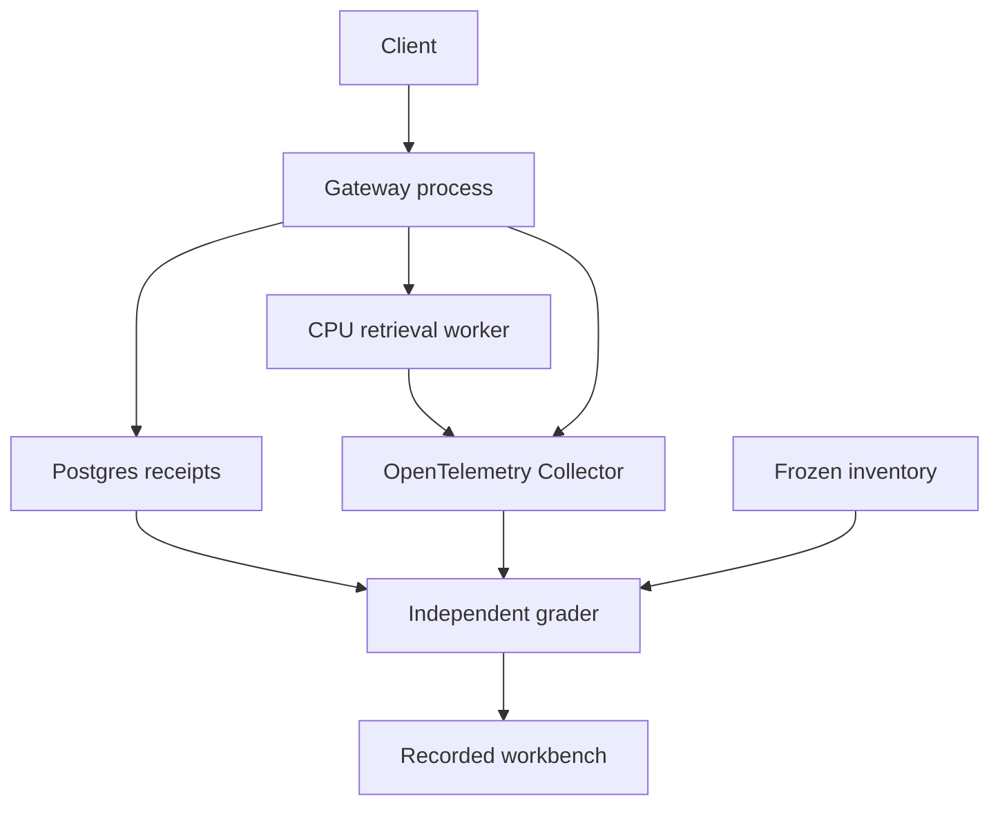

# Tracepath

Tracepath answers two separate questions: did retrieval commit, and did we observe its path? A PostgreSQL receipt records business completion. An independent checker reconciles actual Collector spans against the planned request inventory.

Portfolio observability experiment around a small retrieval service. The corpus and fault cases are authored synthetic fixtures. Actual CPU embedding, live lexical requests and recorded traces are separate. Missing telemetry remains unknown. Results apply to the declared workload, artifacts and environment, not production reliability or general RAG quality.

## Status and evidence

The [live workbench](https://mekala27-45.github.io/tracepath/) and lexical API are published and verified. Final release remains pending. See the checklist for open gates. Read the full eighteen-line [checklist](RESULTS.md), [setup and recovery guide](docs/RUNBOOK.md), [method](docs/METHOD.md), and [review branch](https://github.com/mekala27-45/tracepath/pull/1).

Source 1193110a8e3f91a944d5137d704b367c9776051a; run study-459aa21b5ffe; recorded 2026-11-14T02:38:01.443506+00:00.

Committed primary requests: 24.000 requests; denominator 24. Source artifacts/raw/study-459aa21b5ffe; window 2026-11-14T02:37:47.330382+00:00 to 2026-11-14T02:38:01.443506+00:00; mode actual_cpu_inference.

Matched business outputs: 12.000 pairs; denominator 12. Source artifacts/raw/study-459aa21b5ffe; window 2026-11-14T02:37:47.330382+00:00 to 2026-11-14T02:38:01.443506+00:00; mode actual_cpu_inference.

Median paired tracing overhead: 4.233 ms; denominator 36. Source artifacts/raw/study-459aa21b5ffe; window 2026-11-14T02:37:47.330382+00:00 to 2026-11-14T02:38:01.443506+00:00; mode actual_cpu_inference.

P95 paired tracing overhead: 17.277 ms; denominator 36. Source artifacts/raw/study-459aa21b5ffe; window 2026-11-14T02:37:47.330382+00:00 to 2026-11-14T02:38:01.443506+00:00; mode actual_cpu_inference.

## Architecture

The public request view performs lexical ranking. The recorded Trace, Coverage and Method views display actual CPU evidence. Missing telemetry is incomplete or unavailable. A green trace result does not establish semantic retrieval correctness.

## Reproduce

Install requirements.lock in Python 3.12.14, prepare the pinned model, and follow [RUNBOOK.md](docs/RUNBOOK.md). The [Linux workflow](.github/workflows/verify.yml) exercises actual inference, HTTP process boundaries, a disposable database, fault scenarios, crash recovery and the typed frontend. Recompute retained claims with `python -m scripts.verify_evidence` and `python -m scripts.render_claims`.

The small retrieval contract is adapted from GroundedRAG. See [REUSE.md](REUSE.md), [NOTICE](NOTICE), the three [ADRs](docs/ADR-001-retrieval-reuse.md) and [agent operating rules](AGENTS.md). The original synthetic corpus is CC0. No external messages or social posts were sent.
